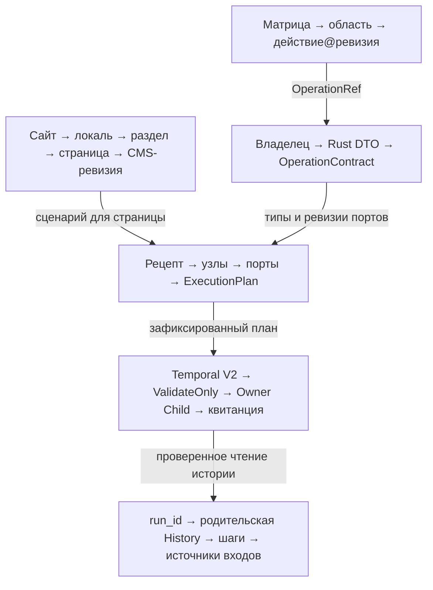

# Issue #94 — source-based candidate decision ledger

**Принятая предметная декомпозиция 28.11.2026:** [единая матрица операций](../app/rust/crates/seo_application/src/site_architect/site_architect_action_matrix_v1.json)
содержит точное соответствие всех 52 исходных строк проектным действиям
(29 KEEP, 12 SPLIT, 11 INTERNAL), 55 уникальных предложенных action IDs
и карту 22 исторических фаз. Три ранее открытые границы
— `load_verified_support_bundle`, `raw_knowledge_ingestion` и
`load_verified_support_bundle.refresh` — получили **source-reviewed решения**
без изменения количества публичных действий. Внешние inventory-пробелы
(PDF/file import и новые поставщики) остаются открытыми.
`python3 automation/check_site_architect_action_matrix.py` сверяет этот
read-only план с исходным Rust/source-аудитом. Это **не** runtime registry,
не решение о допуске эффектов и не утверждение, что 55 действий исполняются.
Нормативное решение — [Issue #94](https://github.com/iamaman11/alegria-site/issues/94).

## Основа siteArchitect для развития проекта



| Граница | Владелец и стабильная связь |
| --- | --- |
| Предметная иерархия | Матрица связывает область и решение с `OperationRef { id, revision }`. Карточка исполнения берётся из каталога по той же паре. |
| Контракт операции | Rust-владелец задаёт `Input`, `Output`, `Failure`, именованные порты, ревизии артефактов, эффекты, идемпотентность и инвалидацию. Схема DTO и отпечаток контракта проверяются по коду владельца. |
| Композиция | `SiteRecipe` связывает внешние артефакты и выходы производителей. `ExecutionPlan` фиксирует граф и контракты в `plan_hash`. `recipe_hash` дополнительно привязывает параметры. |
| Исполнение | `OperationDagMachine` определяет порядок, допустимые волны и привязку результатов. Один узел использует тот же протокол, что и сценарий. Независимые права на эффекты проверяются владельцами. |
| Диагностика | Оператор связывает `run_id` с `plan_hash` и родительским Temporal Run ID. Для завершённого графа чтение повторно собирает квитанцию из проверенных результатов Child через тот же `OperationDagMachine`. `trace` показывает ревизию операции, Child Workflow/Run ID, входные зависимости и хеш квитанции. |

При добавлении действия начинайте со строки матрицы и существующего владельца.
Несовместимое изменение DTO, значения порта или смысла операции оформляйте
новой ревизией соответствующего контракта. Проверьте отдельно запуск одного
узла, совместимую связь в DAG и отказ при неверной версии входа. Для действий
с эффектом приёмка также включает доверенный маршрут, независимый допуск и
проверяемую квитанцию владельца. Команды и правила проверки находятся в
[playbook операций](../automation/NEW_OPERATION_PLAYBOOK.md) и
[операторском runbook](OPS_SITE_ARCHITECT_OPERATOR_V1.md).

## Рабочая схема архитектора сайта

`cli_tools site-architect tools` и MCP `site_architect_tools` возвращают один обзор.
В `matrix.areas` дерево организовано по назначению: получение источников,
извлечение, Truth, Knowledge, планирование сайта, редактура, CMS-ревью и выпуск.
У каждой строки есть решение KEEP/SPLIT/INTERNAL и ссылки на действия по точной
паре `id + revision`. Общий поиск кандидатов виден из двух разделов и имеет
одну карточку в `matrix.actions`. Внутренние строки не предоставляют действий.

| Статус в матрице | Где смотреть типы и что уже можно проверить |
| --- | --- |
| `planned` | `proposed_ports` описывает проектные именованные входы и выходы. У каждого порта есть тип артефакта и ревизия. Владелец сверяет их с реальными данными перед реализацией. |
| `source_declared` | `declaration` ведёт к реализации Rust-контракта с конкретными типами входа, результата и ошибки. В текущем каталоге исполнения эта ревизия отсутствует. |
| `installed_contract` | В `operations` по той же паре находятся фактические порты, настройки, эффекты, идемпотентность и условия запуска. Индивидуальная команда `operation` раскрывает карточку. Допуск и факт исполнения подтверждаются в конкретном запуске. |

**Подключение следующей операции.** Выбрать строку матрицы, согласовать портовые
типы с её производителями и потребителями. В модуле владельца реализовать
`Operation::{Input, Output, Failure}` и `contract()`. Задать схему параметров,
эффекты, идемпотентность и инвалидируемые результаты. Заменить проектные порты
ссылкой на объявление в `declared_rust_contracts`. Зарегистрировать контракт
через существующий каталог владельцев. Рецепт ссылается на тот же ID и ревизию.
Схема и установка сами по себе не дают права на сетевые вызовы, запись или выпуск.

**Целевой рабочий цикл.** Архитектор переходит между деревом сайта (страница и
ревизия), графом сценария (действие, настройки, данные) и конкретным запуском
(узел, попытка, результат или типизированная причина). Для отдельного шага нужны
выбор версии входа, проверка настроек и совместимости, проба на одной странице и
просмотр фактического выхода. Для сценария — запуск до выбранного узла, продолжение
с сохранённого артефакта, варианты от одной точки и сравнение по покрытию,
доказательствам, дублям и навигации. Перед пересчётом видны затронутые результаты
и внешние эффекты. Архитектор принимает просмотренную ревизию и отдельно запускает
выпуск. Эта поставка даёт общую матрицу для цикла; статус каждой дальнейшей
возможности определяется её собственным работающим путём.

### Закрытие трёх legacy phase disposition gaps (28.11.2026)

| Legacy phase | Решение по исходному коду | Связь с предложенными действиями |
| --- | --- | --- |
| `load_verified_support_bundle` | Исходная загрузка уже подтверждённых правил из PostgreSQL с проверкой контекста, scope и applicant profile. Публичная функция — одна типизированная операция чтения; запись run-scoped snapshot остаётся делом владельца. | `KN-02c` → **проектный** `knowledge.verified_rules.load@1` |
| `raw_knowledge_ingestion` | Историческая составная Activity, а не самостоятельная пользовательская операция. Реальный код читает готовые `raw.sections`, регистрирует source/context, вызывает extraction, сохраняет кандидатов, валидирует/адъюдицирует, при подтверждении может записать Verified Truth и проверяет projection barrier. В новом пути эти обязанности должны принадлежать соответствующим отдельным владельцам с их границами прав. | `ACQ-07`, `EX-04`, `TR-05`, `TR-06`, `TR-07`; покрытие **по функциям**, не утверждение о пяти установленных маршрутах |
| `load_verified_support_bundle.refresh` | Повторный вызов того же PostgreSQL reader после изменения Truth. Событие инвалидации и порядок повторного вызова — Temporal runtime, отдельное действие `refresh` не нужно. | Тот же `KN-02c` → `knowledge.verified_rules.load@1` |

Source evidence: `seo_application/src/scenario/{initial_phase,planning_phase}.rs`,
`infrastructure/src/adapters/sqlx_seo_adapter/verified_support.rs`,
`infrastructure/src/adapters/raw_crawl_adapter/{raw_section_ingestion,truth_candidate_persistence}.rs`,
`services/temporal/src/activities/registry/mod_registry_impl.rs` (все под `app/rust`).
Все три решения представлены в проверяемом поле
`legacy_phase_dispositions` JSON-манифеста. **Ни один из предложенных здесь
контрактов не становится `ready` автоматически**; `raw_knowledge_ingestion`
должен остаться только историческим compat/drain-путём до подтверждённой
замены. Source-audit продолжает фиксировать 52 строки / 55 проектных IDs /
22 legacy phases; нового публичного шага эта сверка не создала.

Decision baseline: Draft PR #95 at `851c3fa`, reconciled with canonical [Issue #94 §6.3](https://github.com/iamaman11/alegria-site/issues/94).
Latest fully green exact-SHA PR CI checked for this ledger:
[`d472c4b`](https://github.com/iamaman11/alegria-site/actions/runs/46077079856)
(40 successful jobs, 8 skipped, 0 failed). This CI result verifies the
selected tests on that SHA; it is **not** per-candidate acceptance or a
production deployment.
The full current runtime Activity inventory is generated **directly from Rust** by
`python3 automation/audit_operation_inventory.py --format json`. The legacy
22 phases are generated separately from `SeoPhaseKey` and never become the
normative operation set.

This is an **audit ledger, not a runtime registry**. Decision = proposed
KEEP/MERGE/SPLIT/INTERNAL classification; it does not mean an independent typed
operation was implemented or accepted. Owner is a rule owner or the specific
remaining mixed boundary. Effects include the current Activity/transport
effects, not an authorization grant. `TBD` remains deliberately unresolved.
Reachability denotes source call-site family, not deployed runtime observation.
Paths are repository-relative and checked by the audit script.

## Приёмка по доказательствам (текущий срез Draft PR #95)

### Цель siteArchitect: все пользовательские операции, а не пять демонстраций

Решение владельца проекта от 27.11.2026: единое имя продукта —
**siteArchitect**; любой предметный шаг, пригодный для пользователя, должен
быть независимо доступен для выбора, полного typed authoring, ValidateOnly,
разрешённого Temporal Start, статуса, диагностики и получения результата.
Произвольная композиция должна пользоваться **тем же** проверенным DAG,
а не новым прямым RPC к PostgreSQL, Qdrant, Neo4j или поставщику данных.

Минимальные независимо выбираемые внешние действия: `dataforseo.google_organic.search@1`
(получить SERP по ключевому запросу) и `web.public_page.fetch@1` (скачать
публичную HTTPS-страницу). В текущем коде есть их строго типизированные
контракты, но **нет двух принятых живых владельцев**: DataForSEO ограничен
HTTP fixture, web fetch не установлен как разрешённый Temporal owner. До
подтверждённого одиночного E2E и авторизованного Start статус — `needs_adapter`,
не `ready`; прямое исполнение через общий MCP недопустимо.

В базовой матрице **41 потенциально пользовательская строка** (29 KEEP +
12 SPLIT) и **11 INTERNAL**, которые не следует искусственно превращать в
видимые инструменты. SPLIT может дать несколько новых независимых контрактов,
поэтому конечное количество настоящих пользовательских операций уточняется
по реализованным owner boundaries, а не объявляется равным 41 или 52 заранее.
Обязательная цель — покрыть **каждую** из 41 строк реальными готовыми
контрактами (или документированным отказом от первоначальной классификации),
не считать пять pure-операций завершением программы.

Для каждого исполняемого контракта необходимы: точные Rust Input/Output/Failure
DTO и структурный owner-issued schema descriptor; независимые owner build,
deployment/readiness и `ValidateOnly`; one-step Temporal History, tenant/ACL,
budget и effect admission; реальный typed owner receipt и source attestation
там, где есть внешние эффекты; успешный/отрицательный E2E и replay на точном
SHA. Только после этого siteArchitect может показывать статус **готово к
исполнению**. Предварительный каталог и structural preview не равны работе.

До прохождения этой приёмки показатели остаются фактическими: пять
установленных pure-операций, отдельные пока не установленные owner-only контракты,
**0/52 fully accepted**. Переименование интерфейса не изменяет ни эти
числа, ни сохранённые Temporal History или SQL authority identities.

### Фактический CI-бюджет и безопасная граница миграции

На exact-SHA `d472c4b` обязательный PR CI прошёл за **351 с (5:51)**;
цель **1–3 минуты пока не достигнута**. После ускорения Rust `verify`
критический путь проходит через исторический `rust-e2e-legacy-binaries`
(226 с, из них 194 с Cargo build), native Temporal harness (189 с)
и зависящий от них реальный legacy E2E (81 с). Три старых бинарника
собираются **одним** Cargo invocation: простое разнесение их по jobs
повторно скомпилирует общие зависимости и не является подтверждённым
ускорением.

`temporal_worker` пока содержит действующие legacy Activity с прямыми
зависимостями от PostgreSQL, Qdrant и Neo4j; новый generic
`temporal_orchestrator` уже отделён от этих провайдеров по умолчанию.
Следующая оптимизация требует переноса конкретных Activity к их
владельцам с сохранением старых Workflow Types и зарегистрированных
Activity до доказанного replay прежних History. Принимать такой перенос
можно только по exact-SHA independent owner build/ValidateOnly, реальным
Temporal E2E/replay, tenant/ACL/effect отказам и замеру *полного* PR CI
до/после. Исторический Worker остаётся совместимым, пока это не доказано.

### Дополнительный owner-local срез (полная приёмка всё ещё ожидается)

В независимых предметных модулях подготовлены **13 отдельных pure-контрактов**
для кандидатов матрицы. Они не добавлены в пользовательский каталог
siteArchitect, пока нет доказанного владельцем исполняемого пути. Этот
перечень показывает продвижение по source-level разработке, **не 13 новых
работающих кнопок**:

| Строка | Версионированная операция | Граница владельца |
| --- | --- | --- |
| ACQ-01 | `acquisition.classify_source_page@1` | `acquisition` |
| ACQ-02 | `acquisition.evaluate_dom_blocks@1` | `acquisition` |
| EX-04 | `seo_steps.extract_procedural_rules@1` | `seo_steps` |
| EX-07 split A | `semantic.seo_signals@1` | `seo_signal_extraction` |
| EX-07 split B | `semantic.commercial_signals@1` | `commercial_signal_extraction` |
| TR-02 | `truth.judge_completeness@1` | `truth_domain` |
| TR-03 | `truth.detect_contradictions@1` | `truth_domain` |
| PL-02 | `seo_steps.normalize_serp_queries@1` | `seo_steps` |
| PL-03 | `seo_steps.build_seo_opportunities@1` | `seo_steps` |
| ED-04a | `ValidateContentContract` | `seo_domain` |
| ED-04b | `ValidateDraftQuality` | `seo_domain` |
| PUB-02 | `ValidateRenderPreview` | `seo_domain` |
| PUB-04 | `DetectRebuildImpact` | `seo_domain` |

Для ACQ-01/02 добавлен изолированный, **opt-in** native Temporal пакет
`temporal_acquisition_pure`, фиксированная очередь
`alegria-acquisition-pure-owner-v1` и два отдельных Workflow Types
`AlegriaOwnerValidateV1Workflow`/`AlegriaOwnerOperationV1Workflow`.
Выпуск worker binary не создаёт сам по себе trusted deployment route в
generic DAG parent; нельзя обходить issuer, tenant, бюджет или owner History.
До появления независимой проверки Temporal History предыдущего Child этот
Worker **отклоняет Produced-входы**, даже при согласованных локальных hash;
текущий исходный срез пригоден только для External-артефактов с отдельно
организованным admission. Источник URL/документа сам по себе не аттестован.
Следующий физический срез CI добавляет opt-in тест
`acquisition_native_v2_both_independent_one_step_operations_and_replay`:
два отдельных one-node старта на подлинном Temporal 1.32/PostgreSQL 18,
независимые ValidateOnly и owner Child, V3-структурный root-owned каталог,
типизированные результаты, негативный неизвестный DTO-параметр и native
SDK replay captured server History на собственном exact-SHA бинарнике.
До успешного прогона и отдельной tenant/issuer аттестации это **не** новый
принятый пользовательский инструмент и не production-ready маршрут.
Нативные server History, активный Build-ID, индивидуальные приемочные
прогоны и пользовательская регистрация для этих 13 операций **отсутствуют**.
`SPLIT` не закрыт чистой половиной, когда в исходной операции остаются
внешние эффекты. Цель — покрыть каждую релевантную строку, а не остановиться
на этом source-only срезе.
Отдельная ACQ-02 возвращает только *сырые оценки блоков*: в исходном
`extraction_prelude` запрет структурного извлечения из ACQ-01 дополнительно
сбрасывает `allow_extraction` у **всех** блоков. Композиция, в которой
положительный ответ ACQ-02 обходил бы page-level gate, недопустима.

В PR #96 `acquisition.prepare_entity_span_input@1` объединяет эти проверки
для одного переданного блока. Его выход и вход `semantic.entity_spans@1`
используют общий Rust-контракт `semantic.entity_span_input@1`. Далее
`semantic.canonicalize_mentions@1` принимает результат извлечения. Нативный
сценарий V2 сверяет обе связи по истории Temporal и читает три шага по
одному `run_id`. [Порты и настройки воркеров](OPS_SITE_ARCHITECT_OPERATOR_V1.md#связка-acquisition-и-семантики)

### Новая проверяемая структурная граница (после исходного baseline)

Новый owner-local код `seo_application::operation_adapter::owner_dto_schema`
генерирует JSON Schema draft 2020-12 **непосредственно из Rust DTO** пяти
`semantic.*` операций из `JsonSchema` derives. Генератор явно использует
`SchemaSettings::draft2020_12().for_deserialize()` для фактического входного
Serde wire (`Input`) и `for_serialize()` для выходного wire (`Output`):
расхождения `rename`/`skip_serializing` нельзя маскировать общей схемой.
Для этих пяти безошибочных pure-операций доменный `Failure = Infallible`:
структурная wire-схема Failure — логическое `false`, что не выдумывает
несуществующий сериализуемый error payload. Rust-регрессии проверяют
изменение дескриптора при смене типа поля, `Option` или enum-варианта,
а также вложенные структуры и реальные `serde`-имена. **Это пока только
пять конкретных owner DTO, не все 52 строки матрицы.**

`operation_protocol::owner_schema_v3` сохраняет owner DTO descriptors как
ограниченные по размеру, версионированные байты; проверяет идентичности,
порты, целостность pin/fingerprint, а для JSON Schema направляет строго
ограниченную проверку в `owner_schema_json`. Для **Protobuf
FileDescriptorSet** ядро сохраняет только непрозрачные байты — никаких
`prost`/`prost-types` зависимостей у `operation_protocol` нет. Реальная
декодировка Protobuf descriptor и отказ на повреждённые/пустые наборы
выполняется **при доверенной установке** в `trusted_owner_catalog`, а не
транзитивно через все domain crates. Это проверка корректности границы IDL,
**не доказательство соответствия чужих дескрипторов их настоящим DTO**.
Независимая установка
версионированных схем доступна в `trusted_owner_catalog` из доверенного
root-owned каталога, а входной self-sealed pin сверяется с установленным.
Для `schema_revision=3` эффектные owner routes требуют собственного
`owner_schema`, а отдельные `schema_entries` предназначены только для
бесэффектных pure-контрактов. Чистым операциям не создаётся фиктивная
эффектная Temporal Child Route. Записанный в trusted catalog `build_id`
должен быть дополнительно подтверждён как идентичность действительно
запущенного owner Worker; один правильный SHA-подобный текст сам по себе
не удостоверяет запущенный бинарник. Параметр `parameter_schema` siteArchitect
не эквивалентен полной owner DTO-схеме и не выдаёт admission.

Новый opt-in `AlegriaPureOperationDagV3Workflow` / `alegria-pure-dag-v5`
фиксирует в immutable Temporal Start input версионированные структурные
схемы запрошенных pure-операций и перед исполнением сравнивает их с
owner-generated DTO схемами **из скомпилированного владельца**.
Существующие V3/V4 Workflow Types, очереди и V2 fingerprints сохраняются.
Источник authority для V5 pure — linked owner implementation; конфигурация
каталога эффектных owner и их внешний issuer остаются отдельной границей.

Успешный full CI на `d472c4b` подтверждает выбранные CI-тесты на этом SHA,
включая заявленные native Temporal E2E/replay suites. Но это **не**
индивидуальная аттестация всех кандидатов: source-level Python/mutation gates
сами по себе не доказывают серверную History, а локально записанная
History **не заменяет replay исторической production History**.

Нельзя изменять показатель `0/52`, пока для каждой конкретной строки
не приложены индивидуальные source, native Temporal и owner receipt
evidence, включая негативные эффекты и отказ при чужом tenant.

В этой таблице **52 предварительных кандидата** (29 KEEP, 12 SPLIT,
11 INTERNAL), но **не 52 принятые самостоятельные операции**. Полный
машинно-читаемый source-audit, включая отдельную строку и степень проверки
для каждого кандидата:

```bash
python3 automation/audit_operation_inventory.py --format summary
python3 automation/audit_operation_inventory.py --format readiness
python3 automation/audit_operation_inventory.py --format json
```

Нельзя отождествлять число кандидатов с 73 Temporal Activity endpoints,
22 историческими `SeoPhaseKey` или пятью *уже установленными* pure-контрактами
`semantic.*`. Их исходные Rust `Operation`-контракты привязаны к
`seo_application::operation_adapter::semantic_extraction_registry`; пять
отдельных one-node DAG unit tests проверяют прямой typed-вызов каждого
контракта и отказ на чужой scope/неверный payload/schema. Это **проверка
пути по исходникам и unit-тесты**, не подтверждённый production Temporal E2E.

`ACQ-01` и `ACQ-02` дополнительно выделены в `acquisition::operations` как
строгие типизированные *owner-only* pure-контракты: DTO не изменяют
десериализацию исторических Temporal V1 payload. **Они не включены** в
`semantic_extraction_registry`, siteArchitect или пользовательский Temporal
исполнитель и потому не прибавляются к пяти установленным операциям.
Для `EX-03` исполнена только pure-часть SPLIT, не внешний Qdrant enrichment.

| Доказательство | Уровень, который оно подтверждает | Текущий статус |
| --- | --- | --- |
| Строка матрицы, исходный owner и классификация | Source inventory | 52/52 записаны; финальные границы не утверждены |
| Rust typed `Input`/`Output`/`Failure`, versioned `Operation::contract` | Source-level owner contract; **компиляция требует CI** | 5 `semantic.*` + 13 owner-only (включая 2 ACQ); не все 52 |
| Доверенная регистрация и однозначный исполнитель | Source-level installed/dispatch | 5 `semantic.*`; новые 13 — нет |
| Независимый one-node вызов и отрицательные случаи | Unit tests + после прогона CI проверка на SHA | Новые тесты для пяти pure; не подтверждает эффектные owner-гейты |
| Native Temporal History, PG/Outbox owner receipt, replay, failures, tenant isolation | Physical E2E **на конкретном SHA** | 0 из 52 атрибутированы как fully-accepted |
| Режимы production: RLS, provider budgets, rollback, Build-ID/drain | Production readiness | Не утверждено |

Даже завершение unit-тестов пяти pure-операций **не закрывает** кандидатов
с внешними эффектами, не подтверждает каждый `SPLIT` целиком, не разрешает
использовать fixture-only DataForSEO как live-provider proof. Полных
приёмок по §6.3 — **0**, ожидают окончательной приёмки **52**. Скрипт
сознательно использует `not_verified` там, где нет надёжной положительной
атрибуции, а не утверждает, что нужный код отсутствует.

Выявленные отрицательные критерии на следующую приёмку: в новом срезе
`TR-01` заменяет `unwrap()` при соединении section-id на типизированный
`DomainError::ContractViolation`; положительный и два отрицательных теста
требуют CI-подтверждения на новом SHA. `PL-01` pure-модель выдаёт только *предварительное* число SERP
snapshots, а фактический PG/provider receipt принадлежит application;
`ED-05` PII prepass сейчас встроен в сборку черновика, а `CMS-01a`/`CMS-02`
различаются `publish_mode` одного обработчика. `PUB-01` и `PUB-03` пока
совмещают PG/FS/CDN эффекты; их отдельный эффектный admission не доказан.

## Почему Protobuf и JSON существуют одновременно

**Не было миграции «с Proto на JSON».** Legacy-путь хранит/передаёт
`alegria.temporal.v1` protobuf DTO из `app/contracts/proto/temporal_payloads.proto`
через `prost`; рядом уже исторически используются JSON DTO для части
ACQ/EX/TR (в `proto_runtime_payload_store/registered_payload_impls.rs`
статически зарегистрированы **43 protobuf и 24 JSON** типа). Даже старый
`StepEnvelope` имел строковый type tag и непрозрачные `bytes`, а некоторые
протокольные сообщения содержат `sections_json` или `extra_json_utf8`.

Новый динамический DAG использует **один provider-free Rust-протокол**
`operation_protocol::Operation<Input, Output, Failure>` и проверяемую
`OperationContract`/pinned fingerprint; формат JSON применяется для
редактируемого siteArchitect authoring и конкретных сериализованных данных.
Проверку конкретных DTO выполняет владелец, а не неограниченный словарь
внутри orchestration. siteArchitect remote owner требует отдельного
`ValidateOnly`; JSON schema от автора сама по себе не даёт права запуска.

**Остающийся P0:** `OperationContract::fingerprint()` включает ID/revisions,
порты, владельца и effects, но **не полный структурный descriptor полей
Rust Input/Output/Failure**. Изменение DTO без ревизии может оставить прежний
hash. На текущей V2 History-схеме нельзя добавить descriptor in-place,
поскольку это изменит исторические pinned fingerprints. В отдельном
`operation_protocol::owner_schema_v3` предоставляет независимые Input/Output/
Failure descriptor bytes, ограничение размера, собственный fingerprint и
сверку с доверенным owner pin. Для пяти semantic pure DTO теперь добавлены
реальная owner-side генерация и отдельный Temporal V5 History-контракт,
но масштабирование на остальных владельцев, публичная регистрация,
production доверие к live source/provider и доработка owner Failure wire
для fallible операций остаются P0. V2 Contract/History не меняются.
Проверки raw duplicate JSON и typed round-trip в pure-исполнителе
защищают от молча проигнорированных параметров **сейчас**, но не заменяют
полного структурного descriptor. Исходные boundary regressions:
`python3 automation/test_operation_wire_boundary.py`; эти source-checks
не доказывают E2E всех 52 кандидатов.

В CI дополнительно запинены **декларации legacy Protobuf V1**, включая
импорт `condition.proto`, и неизменяемый сериализуемый layout/Blake3
fingerprint `OperationContract` V2. Комментарии и форматирование Proto не
считаются изменением деклараций; добавление/замена полей старой версии
обязательно требует отдельного review на исторический replay. Это защищает
старый wire от случайного изменения, но **не удостоверяет** полную структуру
owner DTO и не может заменить отдельную V3 schema attestation.

Проверки authoring и pure artifact ingress используют один нейтральный
`seo_application::typed_json`: отказ на дубли ключей, проверка сохранности
авторских полей и нормализация через фактический Serde wire (включая `f32`,
без ложного отказа при представлении `f32` как `f64`). Это **не** новая
предметная IDL и не отдельный каталог операций. Консервативно отклоняются
alias/skip-поля, которые не сохранили исходное JSON-представление.

**Temporal V3/V4 replay boundary:** исторический V3 Workflow Type
`AlegriaPureOperationDagV1Workflow` на очереди `alegria-pure-dag-v3`
продолжает вызывать `execute_pure_dag_legacy_v3` с прежним Serde ingress и
`String`-результатом. Новая строгая проверка относится к отдельному V4
Workflow Type `AlegriaPureOperationDagV2Workflow`, очереди
`alegria-pure-dag-v4`, типизированному `PureDagReceipt` и отдельному
`ALLOW_PURE_DAG_ORCHESTRATOR_V4` opt-in. Один бинарник worker, новые
бизнес-операции не добавляются; одна очередь не подменяет другую.
Сохранение исходного пути V3 проверяется статическими негативными тестами,
но **фактический replay сохранённых V3 Histories по server History ещё
требует проверки** перед deployment. Отсутствие изменений в Protobuf V1
само по себе не доказывает совместимость всех исторических запусков.

Verified static reachability at the baseline: 55 Activity methods referenced
from canonical V1, 14 additional expert-only methods, two other operational
workflows, two test-only methods; V2 source-only reuses five of the existing
methods (not five new business operations). New generic pure-DAG Workflow
does not turn any of these technical methods into a required fixed site step.

| Candidate | Decision | Owner (actual/proposed) | Effects and boundaries | Reachability | Source |
| --- | --- | --- | --- | --- | --- |
| ACQ-01 | KEEP | acquisition | PURE classifier; Temporal journal | expert+V1 | app/rust/crates/acquisition/src/source_relevance.rs |
| ACQ-02 | KEEP | acquisition | PURE relevance; Temporal journal and PG sweep read | expert+V1 | app/rust/crates/acquisition/src/source_relevance.rs |
| ACQ-03 | INTERNAL | acquisition | PURE extraction prelude, not site step | application-internal | app/rust/crates/acquisition/src/source_relevance.rs |
| ACQ-04a | INTERNAL | acquisition | PURE HTML metadata parsing | application-internal | app/rust/crates/acquisition/src/html_sections.rs |
| ACQ-04b | KEEP | acquisition | PURE sectioning; Activity PG input/journal | V1 | app/rust/crates/acquisition/src/html_sections.rs |
| ACQ-05 | KEEP | acquisition | PURE PDF parser; external file acquisition separate | application-internal | app/rust/crates/acquisition/src/pdf_parser.rs |
| ACQ-06 | INTERNAL | acquisition | PURE robots/retry policy; HTTP execution separate | application-internal | app/rust/crates/acquisition/src/crawl_policy.rs |
| ACQ-07 | SPLIT | acquisition + PG runtime | HTTP crawl, raw PG, optional Qdrant projection; fence TBD | V1+CLI | app/rust/services/cli_tools/src/cli/static_site.rs |
| EX-01 | KEEP | seo_domain extraction | PURE route; PG journal in Activity | expert+V1 | app/rust/crates/seo_domain/src/extraction/layer_routing.rs |
| EX-02 | KEEP | seo_domain extraction | PURE spans; PG journal in Activity | expert+V1 | app/rust/crates/seo_domain/src/extraction/entity_spans.rs |
| EX-03 | SPLIT | seo_domain canonical mapping + knowledge vector port | PURE alias mapping versus Qdrant lookup; optional enrichment not Truth authority | expert+V1+pure-DAG | app/rust/crates/seo_domain/src/canonical_mapping.rs;app/rust/crates/seo_application/src/knowledge.rs |
| EX-04 | KEEP | seo_steps procedural rule | PURE extraction; Activity PG journal | expert+V1 | app/rust/crates/seo_steps/src/procedural_extraction_step.rs |
| EX-05 | KEEP | seo_domain extraction | PURE operational facts; Activity PG journal | expert+V1+pure-DAG | app/rust/crates/seo_domain/src/extraction/operational_entities.rs |
| EX-06 | KEEP | seo_domain extraction | PURE topics; Activity PG journal | expert+V1+pure-DAG | app/rust/crates/seo_domain/src/extraction/editorial_topics.rs |
| EX-07 | SPLIT | seo_domain TBD: SEO signal + commercial signal | Two distinct inline rules, PG section read and Activity journal; owner extraction pending | V1 | app/rust/services/temporal/src/activities/operations/truth_extraction_ops/layered_extraction.rs |
| EX-08a | INTERNAL | seo_steps ontology gate | PURE validation; Activity journal | V1 | app/rust/services/temporal/src/activities/operations/truth_extraction_ops/layered_extraction.rs |
| EX-08b | INTERNAL | seo_steps contract gate | PURE schema check; Activity journal | V1 | app/rust/services/temporal/src/activities/operations/truth_extraction_ops/candidate_validation.rs |
| EX-08c | INTERNAL | acquisition + seo_steps gate | PURE CAS and sectioning checks; PG journal | V1 | app/rust/services/temporal/src/activities/operations/acquisition_section_ops.rs |
| TR-01 | KEEP | truth_domain + seo_steps | PURE triple synthesis; Activity journal | expert+V1 | app/rust/services/temporal/src/activities/operations/truth_extraction_ops/triple_builder.rs |
| TR-02 | KEEP | truth_domain | PURE completeness decision; Activity journal | expert+V1 | app/rust/crates/truth_domain/src/completeness.rs |
| TR-03 | KEEP | truth_domain | PURE contradiction decision; Activity journal | expert+V1 | app/rust/crates/truth_domain/src/review_decisions.rs |
| TR-04a | INTERNAL | truth_domain | PURE HITL routing policy; PG task is separate | expert | app/rust/crates/truth_domain/src/hitl_decision.rs |
| TR-04b | KEEP | truth_domain | PURE conflict resolution; Activity journal | V1 | app/rust/crates/truth_domain/src/review_decisions.rs |
| TR-05 | KEEP | truth_domain + Temporal candidate adapter | PURE candidate/quantity validation; PG manual queue read | V1 | app/rust/services/temporal/src/activities/operations/truth_extraction_ops/candidate_validation.rs |
| TR-06 | KEEP | truth_domain | PURE governance/adjudication; PG journal | V1 | app/rust/crates/truth_domain/src/semantic_truth_write.rs |
| TR-07 | KEEP | truth_domain policy + PG transaction owner | PostgreSQL atomic Truth/HITL/Outbox/step journal; COMMIT fence is mandatory | V1 | app/rust/crates/infrastructure/src/adapters/sqlx_truth_write_adapter.rs |
| TR-08 | SPLIT | truth_domain + PG manual queue + Temporal wait | Manual task persisted in PG, wakeup signal, typed human decision | V1+CLI | app/rust/services/temporal/src/workflows/seo_site_build_canonical_cutover/manual_truth_gate.rs;app/rust/services/cli_tools/src/cli/manual_llm.rs |
| TR-09 | INTERNAL | seo_domain page readiness | PURE verified support admissibility; Activity journal | V1 | app/rust/crates/seo_domain/src/page_readiness.rs |
| KN-01a | INTERNAL | seo_application knowledge | PG source-context read; retrieval cache is not Truth | V1+application | app/rust/crates/seo_application/src/knowledge.rs |
| KN-01b | INTERNAL | seo_application knowledge | Qdrant semantic read/rerank; no authoritative mutation | V1+application | app/rust/crates/seo_application/src/knowledge.rs |
| KN-02a | SPLIT | seo_domain mapping + seo_application knowledge | Optional Qdrant read, retains HITL; not merged with pure canonical mapping | V1+application | app/rust/crates/seo_application/src/knowledge.rs |
| KN-02b | INTERNAL | vector/embedding adapter | Voyage embedding preparation; external I/O | V1+application | app/rust/crates/runtime_composition/src/adapters/semantic_search_adapter.rs |
| KN-02c | KEEP | seo_application knowledge | Verified PostgreSQL rule read; PURE verified-block rendering | V1+application | app/rust/crates/seo_application/src/knowledge.rs |
| PL-01 | SPLIT | seo_application SERP + PG owner | External SERP provider read and PG persist separated | V1+semi-auto | app/rust/crates/seo_steps/src/serp_ingest_step.rs |
| PL-02 | KEEP | seo_steps SERP | PURE normalize; PG journal in Activity | V1+semi-auto | app/rust/crates/seo_steps/src/serp_normalize_step.rs |
| PL-03 | KEEP | seo_steps opportunity | PURE discovery; PG persistence separately | V1+semi-auto | app/rust/crates/seo_steps/src/opportunity_build_step.rs |
| PL-04 | KEEP | seo_domain IA + seo_steps | PURE page/blueprint planning; PG persistence separately | V1+semi-auto | app/rust/crates/seo_steps/src/ia_build_step.rs |
| PL-05 | KEEP | seo_domain link policy | PURE scoped page-link rules; PG/Neo4j projection separately | V1+semi-auto | app/rust/crates/seo_domain/src/link_recommendation.rs |
| PL-06 | SPLIT | seo_steps reconcile policy + PG atomic owner | Global site plan and navigation, one PG transaction + Outbox | V1+semi-auto | app/rust/crates/seo_steps/src/global_site_reconcile_step.rs |
| ED-01 | KEEP | seo_steps editorial | PURE draft assembly; input references verified Truth | V1+semi-auto | app/rust/crates/seo_steps/src/draft_assemble_step.rs |
| ED-02 | SPLIT | seo_application editorial + LLM/PG manual queue | External LLM draft and optional manual human submission | V1+CLI | app/rust/services/cli_tools/src/cli/manual_llm.rs |
| ED-03 | KEEP | seo_steps editorial | PURE normalization; PG journal | V1+semi-auto | app/rust/crates/seo_steps/src/draft_normalize_step.rs |
| ED-04a | KEEP | seo_domain content contract | PURE content validation; PG journal | V1+semi-auto | app/rust/crates/seo_domain/src/content_contract.rs |
| ED-04b | KEEP | seo_domain draft QA | PURE QA policy; PG journal | V1+semi-auto | app/rust/crates/seo_domain/src/draft_quality.rs |
| ED-05 | SPLIT | seo_steps PII sanitizer + seo_domain page readiness | PII sanitization and editorial admissibility are distinct safety policies | V1+semi-auto | app/rust/crates/seo_steps/src/pii_redaction_prepass_step.rs;app/rust/crates/seo_domain/src/page_readiness.rs |
| CMS-01a | KEEP | seo_application CMS review | PG task creation, scoped immutable CMS revision | V1+semi-auto | app/rust/crates/seo_application/src/cms_review.rs |
| CMS-01b | SPLIT | seo_domain CMS decision + PG/Temporal HITL | Human approve/block/reopen; PG durable state plus Temporal wake | V1+CLI | app/rust/crates/seo_application/src/cms_review.rs |
| CMS-02 | KEEP | seo_application review publish + PG owner | Exact approved revision selection; PG transaction | V1+semi-auto | app/rust/crates/seo_application/src/review_publish.rs |
| PUB-01 | SPLIT | seo_domain publishing + infrastructure renderer | PG read and candidate static filesystem materialization; no delivery authorization | V1+CLI | app/rust/crates/seo_application/src/review_publish.rs |
| PUB-02 | KEEP | seo_domain render preview | PURE output validation; selected readback separate | V1+semi-auto | app/rust/crates/seo_domain/src/render_preview.rs |
| PUB-03 | SPLIT | seo_domain publish policy + PG/FS/CDN owners | Exact CMS freshness fence then remote delivery/readback/rollback | V1+semi-auto | app/rust/crates/seo_application/src/review_publish.rs |
| PUB-04 | KEEP | seo_domain rebuild | PURE affected-pages decision; PG readiness and scheduling separate | V1+semi-auto | app/rust/crates/seo_domain/src/rebuild.rs |

## Explicitly unresolved; no architecture-freeze claim

- Detailed versioned input/output/error contracts and causal artifact
  schemas for all effectful entries have **not** been extracted from Temporal DTOs.
- The choice to KEEP a candidate is **not** proof that it is the final
  business operation; source facts and new research may merge or split it.
- Non-Temporal entrypoints E01–E18 are a separate technical map in
  [ISSUE94_OPERATION_BOUNDARY_DECISIONS.md](ISSUE94_OPERATION_BOUNDARY_DECISIONS.md),
  particularly the direct ontology Qdrant/Neo4j and advisory auto-seed writes.
- `normalize_run_mode` currently maps unknown values to
  `publish_with_hitl` in legacy application code; **generic admission must
  reject unknown run modes before any effect**.
- Three arbitrary real-effect Temporal DAG compositions, provider-side effect
  admission, historical replay and four owner-only rebuild results remain open.
